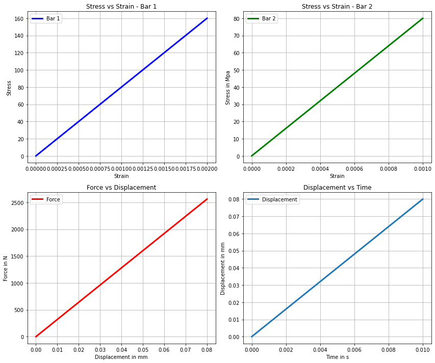
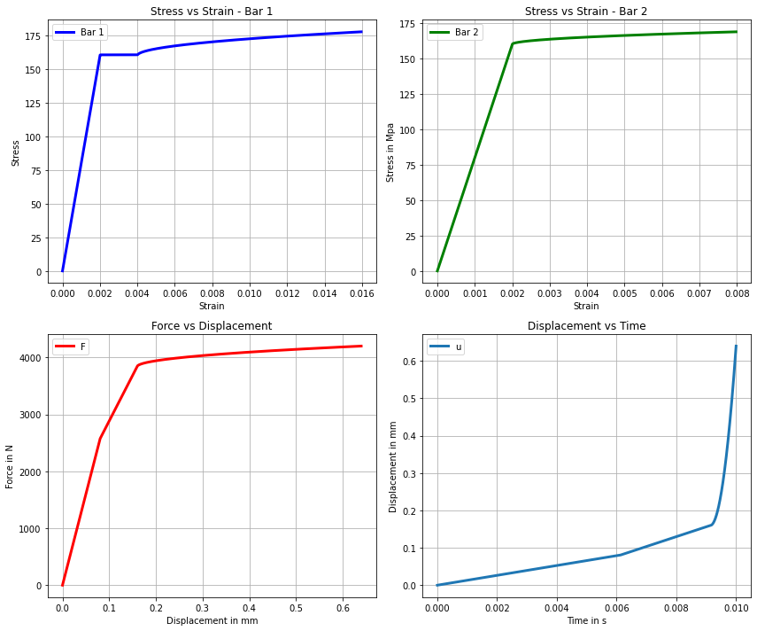
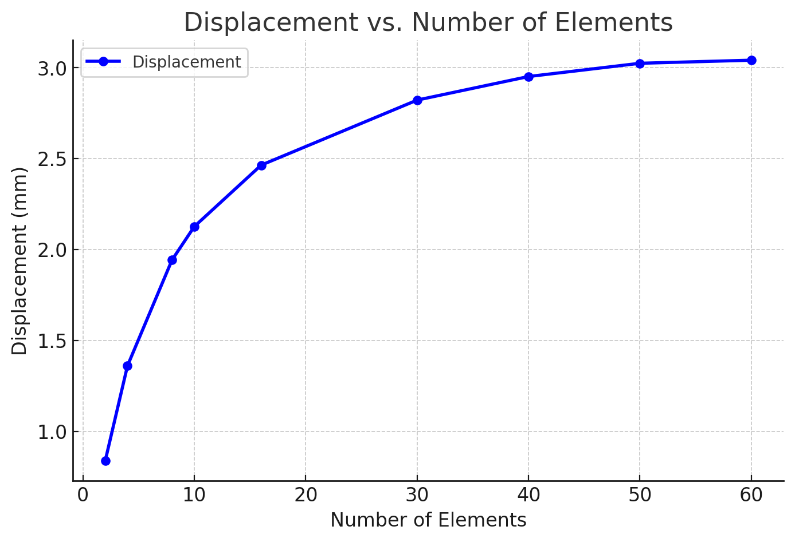

# Nonlinear Finite Element Analysis of a Stepped Viscoplastic Bar

**Computational mechanics · Nonlinear FEM · Rate-dependent constitutive modeling · Newton–Raphson · Python**

A Python implementation of an incremental, **one-dimensional finite-element solver** for a two-segment stepped bar subjected to a force at the junction. The project explores material nonlinearity through a rate-dependent viscoplastic constitutive model, element-level numerical integration, tangent-stiffness assembly and iterative global equilibrium.

> **Numerical status:** This is a research/learning implementation with example results and a detailed project report. The solver's viscoplastic history updates and convergence handling require further verification before its nonlinear response can be treated as a validated benchmark. See [Verification and limitations](docs/VERIFICATION.md).

## Engineering problem

```text
  Fixed end                 Applied force F(t)                 Fixed end
      |                           ↓                              |
      |-------- Bar 1 ------------●------------- Bar 2 ----------|
      |      L₁ = 40 mm                         L₂ = 80 mm         |
      |      A₁ = 8 mm²                         A₂ = 16 mm²         |
```

Both ends are fixed; the prescribed junction force increases incrementally. Different cross-sectional areas produce different stress levels in the two segments.

| Property | Current value |
|---|---:|
| Young's modulus, `E` | 80,000 MPa |
| Reference stress, `σy` | 160 MPa |
| Viscoplastic coefficient, `η` | 50 (code parameter) |
| Rate exponent, `m` | 1 |
| Bar lengths, `L1 / L2` | 40 / 80 mm |
| Areas, `A1 / A2` | 8 / 16 mm² |
| Elements, Bar 1 / Bar 2 | 5 / 5 |
| Maximum junction load | 4,200 N |
| Loading duration / increments | 0.01 s / 4,200 |

## Selected project results

<p align="center">
  
  
</p>
<p align="center"><em>Archived elastic and viscoplastic response figures. These demonstrate the project workflow; they are not independent validation evidence.</em></p>

<p align="center">
  
</p>
<p align="center"><em>Archived mesh/discretization investigation.</em></p>

## Numerical formulation

**Finite elements.** The implementation uses two-node, one-dimensional bar elements with linear Lagrange interpolation and two-point Gauss quadrature. At each integration point,

$$
 u_h(x)=\mathbf N(x)\mathbf u_e,\qquad
 \varepsilon=\mathbf B\mathbf u_e,\qquad
 \mathbf B=\frac{d\mathbf N}{dx}.
$$

The material routine separates elastic and viscoplastic strain,

$$
 \varepsilon=\varepsilon^e+\varepsilon^p,\qquad
 \sigma=E(\varepsilon-\varepsilon^p).
$$

An elastic trial stress is evaluated as $\sigma_{\mathrm{tr}}=E(\varepsilon-\varepsilon_p^n)$. An overstress criterion based on $|\sigma_{\mathrm{tr}}|/\sigma_y$ selects the elastic or active viscoplastic branch; the present source code implements the active correction for the configured **$m=1$** case.

**Element equilibrium and tangent stiffness.** The code assembles

$$
 \mathbf f_{\mathrm{int}}^e=\int_{\Omega_e}\mathbf B^T\sigma A\,dx,
 \qquad
 \mathbf K_T^e=\int_{\Omega_e}\mathbf B^T C_T\mathbf B A\,dx,
$$

and uses the Newton–Raphson correction

$$
 \mathbf K_T^{(i)}\Delta\mathbf u^{(i)}=
 -\big(\mathbf F_{\mathrm{int}}^{(i)}-\mathbf F_{\mathrm{ext}}\big).
$$

The solver applies zero displacement at both external ends and evaluates the response over successive force/time increments. For the detailed constitutive update, numerical quadrature and algorithm description, see [Development notes](docs/DEVELOPMENT_NOTES.md) and the [project report](NLFEM_report.pdf).

## Verification strategy

A useful **analytical elastic reference** for this fixed-ended stepped bar is the junction displacement:

$$
 u_J=\frac{F}{E\left(A_1/L_1+A_2/L_2\right)}.
$$

Using the documented properties, the elastic prediction at **$F=2{,}100\,\mathrm N$** is **$u_J=0.065625\,\mathrm{mm}$**. This is a check to perform against the code output; it is **not** reported as a completed numerical comparison.

Further checks should address element-level constitutive consistency, committed internal-variable history after Newton convergence, load-step sensitivity and convergence against an independent reference. See the [verification matrix and current limitations](docs/VERIFICATION.md).

## Getting started

**Requirements:** Python 3, NumPy and Matplotlib. Dependency versions used to generate the archived figures have not been pinned.

```bash
# Clone
 git clone https://github.com/KartikTandel30/nonlinear-fem-viscoplasticity.git
 cd nonlinear-fem-viscoplasticity

# Install the Python dependencies
 python -m pip install -r requirements.txt

# Run the current solver
 python PVL.py
```

The current script has parameters defined near the beginning of `PVL.py` and displays plots interactively through Matplotlib (`plt.show()`). It does not provide a command-line parameter interface or automatically export all plots. Review the [reproducibility guide](docs/REPRODUCIBILITY.md) before interpreting any regenerated response.

## Repository contents

| Path | Purpose |
|---|---|
| [`PVL.py`](PVL.py) | Standalone nonlinear FEM and material-update implementation |
| [`NLFEM_report.pdf`](NLFEM_report.pdf) | Full technical project report |
| [`Elastic_curve.png`](Elastic_curve.png) | Archived elastic response figure |
| [`Plastic.png`](Plastic.png) | Archived viscoplastic response figure |
| [`Convergense_with_eleme.png`](Convergense_with_eleme.png) | Archived discretization study |
| [`docs/DEVELOPMENT_NOTES.md`](docs/DEVELOPMENT_NOTES.md) | Original detailed README, preserved during update |
| [`docs/VERIFICATION.md`](docs/VERIFICATION.md) | Validation roadmap and source-level limitations |
| [`docs/REPRODUCIBILITY.md`](docs/REPRODUCIBILITY.md) | Execution and environment notes |

## Project context

Developed as a computational mechanics and constitutive-modeling programming project using Python and finite-element methods.

**Author:** Kartik Suresh Tandel — M.Sc. Computational Materials Science, TU Bergakademie Freiberg.
